# On-Call Copilot Architecture

This diagram shows how an incident moves through the On-Call Copilot: from alert ingestion and investigation, through knowledge retrieval and human-approved remediation, to verification and learning.

```mermaid
flowchart TB
    ENG["On-call Engineer"]
    ALERT["Prometheus Alert Rule<br/>→ Alertmanager or Grafana alert<br/>(route still undecided)"]
    UI["FastAPI Incident API and UI"]
    GUARD["Input Guardrails<br/>Telemetry as data · redact secrets"]
    OUTGUARD["Output Guardrails<br/>Claims cite telemetry · no secrets in updates"]

    subgraph ORCH["LangGraph Orchestration — C2 topology"]
        CMD["Incident Commander<br/>Typed state · plan · routing"]
        PLAN["Hypothesize → Gather Evidence<br/>Assess → Replan"]
        STATE[("Incident State<br/>Checkpoint and run history")]
        MEM[("Long-term Memory<br/>Verified incident lessons")]
        CMD <--> PLAN
        CMD <--> STATE
        CMD <--> MEM
    end

    LLM["Shared LLM Service<br/>Reasoning · structured outputs<br/>Tool selection · synthesis"]

    subgraph AGENTS["Specialist Agents"]
        TRI["Triage Agent<br/>Impact · severity · changes"]
        DIAG["Diagnosis Agents × N<br/>One per suspect service<br/>Parallel hypothesis testing"]
        KBAG["Runbook Agent<br/>Retrieve procedures and lessons"]
        REM["Remediation Agent<br/>Propose allow-listed action"]
        COMMS["Communications Agent<br/>Status update · postmortem"]
    end

    subgraph CONTROL["Tool Hooks and Human Control"]
        PRE["Pre-tool Hooks<br/>Per-agent permissions · budget · loop breaker"]
        POST["Post-tool Hooks<br/>Audit · scrub · trace"]
        GATE{"Human Approval Gate<br/>Approve · Edit · Reject"}
        VERIFY["Verify Recovery<br/>Success?"]
        ROLLBACK["Rollback / Escalate<br/>Replan if recovery fails"]
    end

    subgraph MCP["MCP Tool Servers"]
        TEL["Telemetry MCP<br/>Read-only"]
        KB["Runbooks-KB MCP<br/>Read-only"]
        TICK["Tickets MCP<br/>Read / permitted writes"]
        OPS["Ops-Actions MCP<br/>Allow-listed writes · the only path to the world"]
    end

    subgraph DATA["Underlying Systems and Data"]
        PROM[("Prometheus<br/>Metrics")]
        JAEGER[("Jaeger<br/>Distributed Traces")]
        OS[("OpenSearch<br/>Logs")]
        CORPUS[("Runbooks + Postmortems<br/>Hybrid Search Index")]
        INCIDENTS[("Incident DB<br/>Timeline · Tickets · Outcomes")]
        RUNS[("Run Records<br/>One per run · config_id × complexity")]
        SHOP["OpenTelemetry Astronomy Shop<br/>Microservices · Feature Flags"]
    end

    subgraph OBS["Cross-cutting Observability and Evaluation"]
        TRACE["Agent and Tool Traces"]
        EVAL["Evaluation Harness<br/>Golden cases · Fault injection<br/>Drives the API, never imports the graph"]
        DASH["Grafana<br/>Cost · Latency · Errors · Recovery"]
        CI["CI/CD<br/>Regression and Evaluation Gates"]
    end

    ALERT --> UI
    ENG -->|"watch live stream"| UI
    UI --> GUARD
    GUARD --> CMD

    CMD <--> LLM
    TRI <--> LLM
    DIAG <--> LLM
    KBAG <--> LLM
    REM <--> LLM
    COMMS <--> LLM

    CMD --> TRI
    CMD --> DIAG
    CMD --> KBAG
    CMD --> REM
    CMD --> COMMS

    TRI --> PRE
    DIAG --> PRE
    KBAG --> PRE
    COMMS --> PRE
    REM --> PRE

    PRE -->|"Triage · Diagnosis · Remediation — read"| TEL
    PRE -->|"Runbook · Triage — read"| KB
    PRE -->|"Comms only — incident record, status draft"| TICK

    TEL --> POST
    KB --> POST
    TICK --> POST
    POST --> TRI
    POST --> DIAG
    POST --> KBAG
    POST --> COMMS

    KBAG <--> MEM
    COMMS --> INCIDENTS
    TICK <--> INCIDENTS

    PRE -->|"Remediation only"| GATE
    ENG --> GATE
    GATE -->|"Approve exact payload"| OPS
    GATE -->|"Edit: new approval required"| REM
    GATE -->|"Reject"| CMD

    OPS --> POST
    POST --> VERIFY
    TEL --> VERIFY
    VERIFY -->|"Recovered"| CMD
    VERIFY -->|"Not recovered"| ROLLBACK
    ROLLBACK --> CMD
    ROLLBACK -->|"Approved rollback if needed"| GATE

    CMD --> OUTGUARD
    COMMS --> OUTGUARD
    OUTGUARD -->|"checked reply · status note"| UI

    TEL <--> PROM
    TEL <--> JAEGER
    TEL <--> OS
    KB <--> CORPUS
    OPS --> SHOP
    SHOP --> PROM
    SHOP --> JAEGER
    SHOP --> OS

    CMD -.-> TRACE
    PRE -.-> TRACE
    POST -.-> TRACE
    TRACE --> DASH
    EVAL --> DASH
    EVAL --> CI
    EVAL -->|"POST synthetic alert"| UI
    EVAL -. "Inject known faults" .-> SHOP
    CMD -. "One record per run" .-> RUNS
    RUNS -. "Score outcome, cost, stratum" .-> EVAL
    CI -. "Validated version" .-> CMD
    CMD -. "Reviewed lesson candidates" .-> MEM

    classDef control fill:#fff0e6,stroke:#c45a15,color:#44200a
    classDef agent fill:#eaf2ff,stroke:#4778bd,color:#142b4c
    classDef store fill:#eaf7ee,stroke:#3c8b58,color:#153d24
    classDef model fill:#f3e8ff,stroke:#8b5bb5,color:#38204c

    class GATE,PRE,POST,GUARD,OUTGUARD control
    class TRI,DIAG,KBAG,REM,COMMS,CMD,PLAN agent
    class STATE,MEM,PROM,JAEGER,OS,CORPUS,INCIDENTS,RUNS store
    class LLM model
```

## Legend

- **Blue:** orchestration and specialist agents.
- **Purple:** shared LLM service.
- **Green:** data stores and persistent state.
- **Orange:** guardrails, tool hooks and human approval.
- **Solid arrows:** primary runtime interactions.
- **Dashed arrows:** observability, evaluation or improvement feedback.

## Reading the control path

Four things in this diagram are load-bearing for marking, and are worth tracing by hand:

1. **Per-agent tool permissions.** The edges out of `Pre-tool Hooks` are labelled with which
   agents may traverse them. Diagnosis agents reach **telemetry only** — they hold no write
   tools at all, which is half of signature challenge B. Only Remediation reaches the approval
   gate, and `Ops-Actions` is reachable *only* through that gate. Enforcement lives in
   `permissions.py` and `hooks/pre_tool.py`, not in network topology: in HTTP mode every MCP
   server sits on the same Compose network.

2. **Approval binds to the exact payload.** `Edit` does not amend an approval — it routes back
   to Remediation for a fresh one. Any change invalidates what came before.

3. **Both guardrail layers.** Inbound treats all telemetry as data and redacts secrets;
   outbound checks that claims cite telemetry and that no secret reaches a status update.
   Nothing returns to the engineer without passing the outbound layer.

4. **Evaluation measures at the system boundary.** The harness POSTs a synthetic alert to the
   incident API — the same path a real alert takes — and scores from run records. It never
   imports the orchestration package, so the person measuring cannot reach inside what the
   person tuning is changing.

## Scope of this diagram

This is the **C2 topology**: a supervisor with parallel specialists. Experiment E1 also
requires C0 (a fixed workflow with no agent decisions) and C1 (one agent holding all tools),
selected by `oncall_contracts.config.Topology`. Both reuse the same tools, guardrails, gate and
data layer; only the orchestration box changes.

The `Shared LLM Service` box is a simplification. In practice the commander uses a stronger
model than the specialists, and the evaluation judge is a different model family again so that
its agreement with human labels means something.

A logical architecture: individual integrations and tool contracts firm up as the project
develops.
