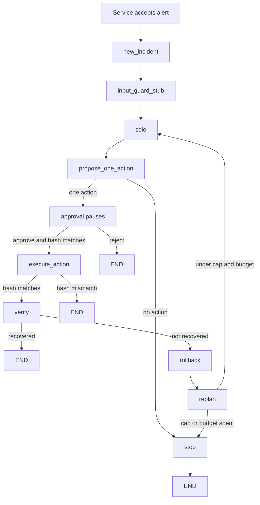

# Solo graph event sequence

- **Date:** 2026-11-01
- **Owner:** P2 — orchestration, planning and improvement
- **Status:** The C1 path that compiles today
- **Package:** `packages/oncall-graph` (`oncall_graph`)
- **Topology:** `c1_single`

This page is the order of events after an alert, for the solo baseline. `oncall-service` is not in this repo. The first and last steps are the service seam in `docs/oncall-graph-contracts.md`. The steps between them are the edges compiled by `build_graph(..., topology="c1_single")`.

C1 writes `oncall_graph.state.IncidentChannel`. That channel carries the nine fields of `oncall_contracts.state.IncidentState` in the contract shape, plus graph-only bookkeeping. The first column is the shared field the step writes. The second column is the private key the step writes.

The monitor is shared by C1 and C2. It is not a team-only graph. The compiled solo edges do not include the monitor node. After a failed verification, solo calls `apply_replan` from the monitor module. The other monitor edges — a timed-out tool, a failed tool, and evidence that contradicts the top hypothesis — run on `build_monitor_graph()` and are not on the solo path yet. The team graph compiles those edges. See `docs/oncall-graph-team.md`.

## Compiled edges



Read tools and the one proposal happen inside `solo`. They do not update state until that node returns. Calling an action tool records a proposal. The shop write waits for approval.

## 1. Service accepts the alert

The service validates the alert and creates `incident_id`. The graph has not started.

| Shared contract | Graph private |
|---|---|
| `alert` is the validated object: `status`, `labels`, `annotations`, `startsAt` | nothing yet |

`scope`, `severity`, `plan`, `verification`, and `proposed_action` are absent. `hypotheses`, `evidence`, and `transcript` are empty.

## 2. Service invokes the graph

`new_incident` opens the channel. The checkpointer thread id is `incident_id`. The graph stores the alert as text. The service keeps the validated object.

| Shared contract | Graph private |
|---|---|
| `alert` is the validated object. A string passed to `new_incident` is stored as the summary of a firing alert | `incident_id`, `stage` `scope`, `status` `RUNNING`, `tool_budget`, `max_revisions`, `tool_calls` 0, `retries` 0, `revisions` 0, `approval_payload_hash` empty, `meter_rows` empty, `transcript` empty, `last` empty, `ok` true, `route` empty, `why` empty, `diagnosis_reports` empty, `pending_rollback` empty |

## 3. `input_guard_stub`

The alert stays data. This stub does not turn text in it into a tool call.

| Shared contract | Graph private |
|---|---|
| `transcript` appends `{kind: "input_guard", text: "input_guard_stub"}` | `status` stays `RUNNING` |

## 4. `solo`

One ReAct loop uses the read tools, then calls one action tool (`set_flag`, `restart`, `scale`, or `rollback`). That call proposes. The shop does not change. If no tool calls remain, the node escalates and step 5 takes the stop branch.

| Shared contract | Graph private |
|---|---|
| `evidence` appends one `{kind, ref, source}` per read. `transcript` appends `{kind: "solo", text: "solo tools N"}` | `tool_calls` increases, `meter_rows` appends one row per model call, `last.result` holds `proposals`, `findings`, and `answer`, `why` holds the agent stop text |

## 5. `propose_one_action`

The solo model does not write a hypothesis. During step 4 it called one proposal tool. `_record` checked that call and stored it under the key `action`. This node takes the last proposal and builds the hypothesis in Python.

`_hypothesis` turns that proposal into one suspect cause. For `set_flag` of `paymentFailure`, the service is `payment` and the statement is `paymentFailure flag`. For the other actions the statement is the action name plus the service. `evidence_refs` are the references recorded in step 4. Confidence is `0.8`, assigned by this code. The hypothesis appends. Older hypotheses stay as they are.

`proposed_action` is the one write waiting for approval:

```python
{
    "action": "set_flag",
    "args": {"flag": "paymentFailure", "enabled": False},
    "expected_effect": "checkout error rate falls under 5%",
    "rollback": "set_flag paymentFailure enabled=true",
}
```

`action` is the command. `args` are its arguments. `expected_effect` is what the model claims will happen. `rollback` is the procedure string. `validate_plan` returns only `{stage, steps}`.

| Shared contract | Graph private |
|---|---|
| `plan` becomes `{stage: "act", steps: []}`. `hypotheses` appends the derived explanation. `proposed_action` is that one write. `transcript` appends `{kind: "propose", text: "proposed one action"}` | `stage` `act`, `route` `approval`, `status` `RUNNING`, `why` cleared |

No proposal: private `status` `ESCALATED`, `route` `stop`, `why` `solo proposed no action`, and `transcript` appends `no action proposed`. The stop node appends `stop` and the run ends. No `proposed_action` is set.

## 6. `approval` pauses

The engineer sees the interrupt: command, expected effect, and payload hash. The hash is SHA-256 of the canonical command. Channel state stays as step 5 left it until resume.

| Resume | Shared contract | Graph private |
|---|---|---|
| Reject | `proposed_action` remains the proposal. No verification. `transcript` appends `approval rejected` | `status` `REJECTED`, `route` `reject`, `why` `engineer rejected the action`, `approval_payload_hash` empty. The run ends. The shop is unchanged |
| Edit | `proposed_action` becomes the edited command on the next interrupt | No channel write. A new interrupt carries the new hash |
| Approve, hash matches | `proposed_action` is the approved command. `plan.stage` stays `act`. `transcript` appends `approval matched` | `stage` `act`, `approval_payload_hash` set, `route` `execute`, `status` `APPROVED`, `why` cleared |

## 7. `execute_action`

The hash is checked again, then the shop write runs.

| Shared contract | Graph private |
|---|---|
| `plan.stage` becomes `verify`. `transcript` appends `executed <action>` | `stage` `verify`, `last` is the applied step and the shop result, `ok` true, `route` `verify` |

A mismatched hash writes nothing to the shop. Private `status` becomes `APPROVAL_MISMATCH`, `route` `stop`, and the run ends.

## 8. `verify`

Code reads the checkout error rate. Recovery is a rate under `0.05`. The model does not decide.

| Shared contract | Graph private |
|---|---|
| `verification` becomes `{recovered, signal: "checkout_error_rate", evidence_refs}`. `plan.stage` is `communicate` when recovered and stays `verify` otherwise. `transcript` appends `verify recovered=<bool>` | `stage` follows the plan. `route` is `recovered` or `rollback`. `status` becomes `RECOVERED` only when recovered. `why` is `verification failed` otherwise |

Recovered ends the run.

## 9. `rollback`

This runs only after a failed verification. Code derives the shop inverse from the action name and its arguments. The procedure string is not executed.

| Shared contract | Graph private |
|---|---|
| `transcript` appends the rollback line. `proposed_action.rollback` stays the procedure string | `pending_rollback` is the shop inverse (`tool` and `args`), `last` is that step and its result, `route` `replan` |

## 10. `replan`

Under the revision cap and the tool budget, the run returns to step 4. This node calls `apply_replan`. It does not run the full monitor.

| Shared contract | Graph private |
|---|---|
| `plan` goes back to `{stage: "hypotheses", steps: []}`. `proposed_action` is cleared. `transcript` appends `replan` | `stage` `hypotheses`, `revisions` increases by one, `retries` reset to 0, `status` `REPLAN`, `route` `solo` |

At the cap or with the budget spent: private `status` `ESCALATED`, `route` `stop`, `why` names the cap or the budget. The stop node appends `stop` and the run ends.

A replan caused by contradicting evidence does not mark the hypothesis. The denial stays on `diagnosis_reports`, which this solo path leaves empty. The top hypothesis is the one with the highest confidence.

## 11. Service writes the run record

This package does not exist yet. The contract says the service maps the finished channel onto `IncidentState` and `RunRecord` after a terminal status.

| Run record field | Taken from |
|---|---|
| `verified_recovery` | `verification.recovered` |
| `rolled_back` | a rollback was applied |
| `tool_calls` | `tool_calls` |
| `tokens`, `model_ids` | `meter_rows` |

`usd` is filled by the service from the token counts. The graph does not invent a price.

## Fields this solo path leaves unset

| Field | Where it lives | Why it stays empty |
|---|---|---|
| `scope` | contract | Triage has not settled the suspect list. Solo has no triage node |
| `severity` | contract | Triage assigns it from the severity policy |
| `diagnosis_reports` | graph private | One envelope per suspect, filled when the team fans out. The monitor reads `local_cause` from it. Solo does not produce these reports |

`diagnosis_reports` and contract `hypotheses` stay separate. A report can deny a local cause without offering a statement, and it carries that copy's tool-call count. The statements inside a report append to `hypotheses`. The private remainder is `{service, local_cause, tool_calls}`.

## How to run the solo demo

`packages/oncall-graph/src/oncall_graph/solo_demo.py` is the live solo run. Pytest keeps the scripted `Shop`. This module builds `Solo` with `LiveShop`.

From the `oncall-copilot` directory:

```bash
export OPENROUTER_API_KEY=...
uv run python -m oncall_graph.solo_demo
```

`Solo()` builds the OpenRouter client before the first call. The key has to be in the environment when the process starts. The model is `openai/gpt-4o-mini` (`SPECIALIST_MODEL` in `oncall_graph.config`). The tool budget is 5. The checkpointer thread id is `astronomy-demo`. The alert text is the `ALERT` constant in `solo_demo.py`.

`promql`, `log_search`, and `traces` read the Astronomy Shop lab. The default host is `10.241.2.69`. Set `ASTRONOMY_SHOP_HOST` to point the three clients at another host. The window is the last five minutes.

| Tool | Lab endpoint |
|---|---|
| `promql` | Prometheus `http://<host>:9090` |
| `log_search` | OpenSearch `http://<host>:32794` |
| `traces` | Jaeger `http://<host>:32797` |

A lab read prints `astronomy shop GET` or `astronomy shop POST` and the URL, then a short result line (`series`, `total`, or `count`). A scripted read prints `scripted shop` and `(no network)`. `search_runbooks`, `incident_record`, and `status_draft` stay on the scripted shop. `recent_changes` is commented out of `READ_TOOLS`, so the model is not offered it. The approval write and the checkout error-rate check stay on the scripted shop. Recovery is still a scripted rate under `0.05`.

The approval checkpointer is in memory. Leave this process running. When the graph pauses it prints `status`, `action`, and `interrupt`. Type `approve` or `reject`. Any other reply is a reject. Approve resumes with the printed `payload_hash`. Reject writes nothing to the shop. After resume the process prints `final status`, `verification`, and `shop writes`.

If the model proposes no action, `interrupt` is empty, `status` is `ESCALATED`, and the process returns without asking.
