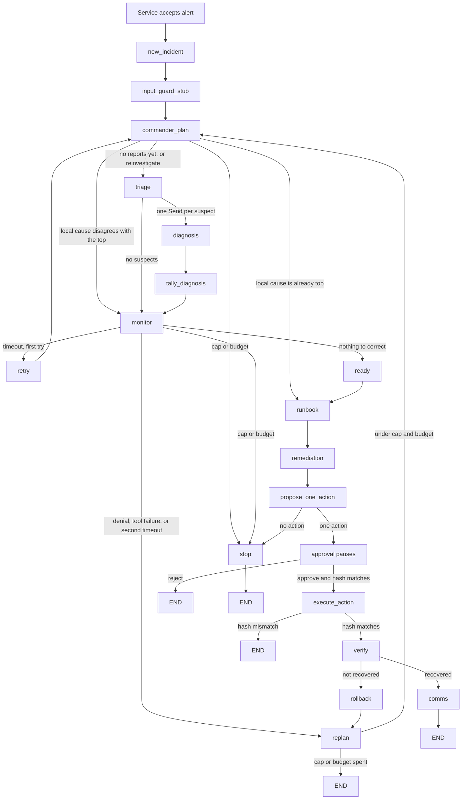
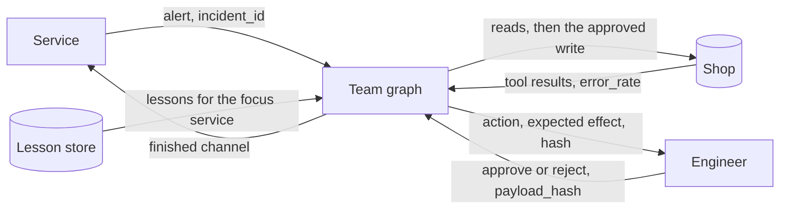
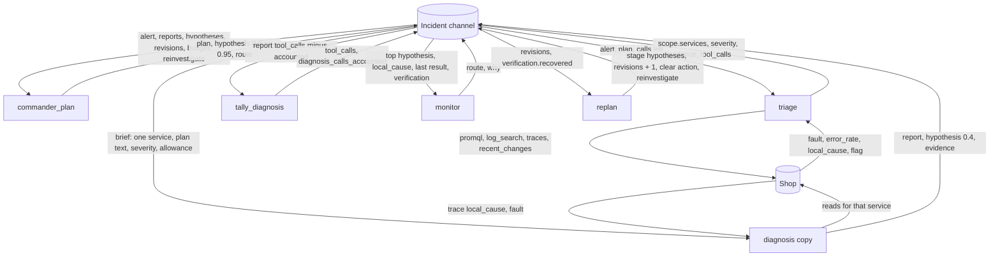
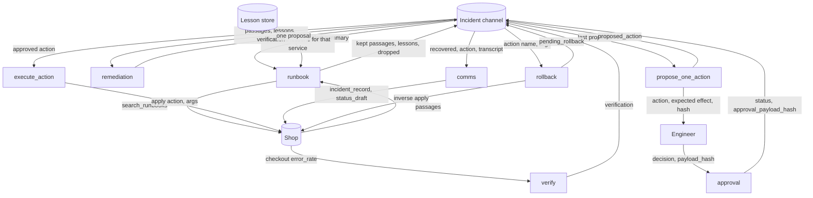
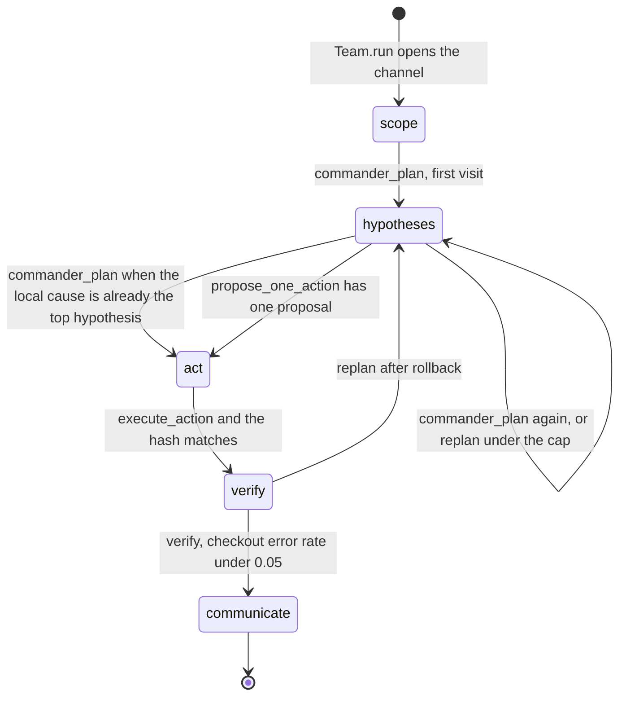
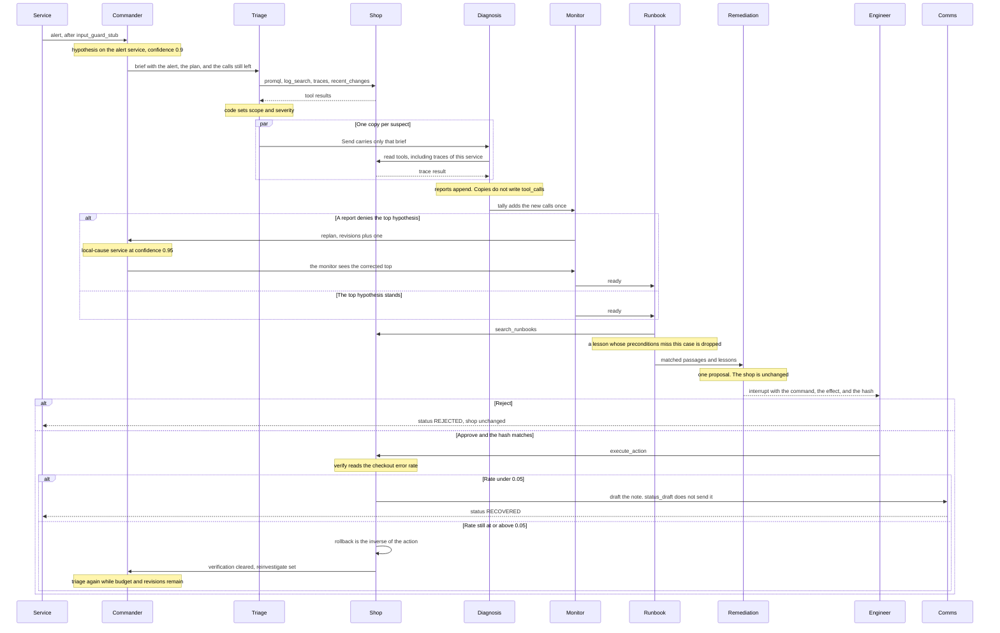

# Team graph event sequence

- **Date:** 2026-11-04
- **Owner:** P2 — orchestration, planning and improvement
- **Status:** The C2 path that compiles today
- **Package:** `packages/oncall-graph` (`oncall_graph`)
- **Topology:** `c2_team` (the default of `build_graph`)

This page is the order of events after an alert, for the commander and the specialists. `oncall-service` is not in this repo. The first and last steps are the service seam in `docs/oncall-graph-contracts.md`. The steps between them are the edges compiled by `build_graph(..., topology="c2_team")`. The solo baseline is `docs/oncall-graph-solo.md`. Approval, execute, verify, and rollback are the same gate. C2 adds the commander, triage, parallel diagnosis, the monitor, the runbook, remediation, and comms.

C2 writes `oncall_graph.state.IncidentChannel`. That channel carries the nine fields of `oncall_contracts.state.IncidentState` in the contract shape, plus graph-only bookkeeping. The first column is the shared field the step writes. The second column is the private key the step writes.

`c0_workflow` still raises `NotImplementedError`. The lesson-review node is not this graph. Comms is the last step on the recovered path.

The model chooses which tool to call. Code assigns severity, builds the hypotheses, drops lessons, and picks every edge. A sentence in a reply does not outrank a trace.

## Compiled edges



`replan` at the cap writes `stop` on the transcript and ends. It does not visit the `stop` node. `commander` and `monitor` do visit that node, and it appends a second `stop` line.

Read tools run inside triage, diagnosis, and the runbook. The proposal runs inside remediation. None of them change the shop. The shop write waits for approval.

## Data flow

The chart above is the control path. This one is the data. The incident channel is the store every node reads and writes. The shop and the lesson store are the other two stores. A diagnosis copy receives a brief, not the channel: alert summary, plan text for that service, severity, and its allowance. It does not receive the transcript or another copy's tool results.



Investigation writes the channel, then the monitor either sends the case on or back.



A copy with no allowance writes `{service, local_cause: false, tool_calls: 0}` and does not call the model. Copies do not write `tool_calls`. `tally_diagnosis` adds the new calls once.

The act path reads that channel. The shop changes only at execute and rollback.



`status_draft` stores a draft. It does not send the note. A failed verification goes to rollback and then `replan`, which clears `verification` and sets `reinvestigate` before the commander runs again.

## Plan stage transitions

`plan.stage` is one of `scope`, `hypotheses`, `test`, `act`, `verify`, `communicate`. The team path writes five of those. `test` is never written. The private `stage` key is a copy of `plan.stage`, except at the runbook: that node sets the private key to `act` while `plan.stage` is still whatever the commander left.



| When | `plan.stage` becomes | Steps |
|---|---|---|
| `Team.run` calls `new_incident`, before any node | `scope` | empty |
| `commander_plan`, no diagnosis reports yet | `hypotheses` | `promql` of `checkout_error_rate`, and `traces` of the alert service |
| `commander_plan`, a report's local cause is not the top hypothesis | `hypotheses` | empty. The `0.95` hypothesis is appended and the route is `monitor` |
| `commander_plan`, a local cause is already the top hypothesis | `act` | empty. The route is `runbook` |
| `commander_plan`, reinvestigate or a failed verification, calls remain | `hypotheses` | empty. The route is `triage` |
| `commander_plan`, no local cause and calls remain | `hypotheses` | empty. The route is `triage` |
| `commander_plan` at the revision cap, or with the budget spent | `hypotheses` | empty. The route is `stop`. The model is not called |
| `replan` under the revision cap and with calls left | `hypotheses` | empty. `proposed_action` is cleared and `revisions` increases by one |
| `propose_one_action` with one proposal | `act` | empty |
| Approval matches the hash | `act` | unchanged |
| `execute_action` and the hash matches | `verify` | unchanged |
| `verify` and the checkout error rate is under `0.05` | `communicate` | unchanged |
| `verify` and the rate is still at or above `0.05` | `verify` | unchanged |
| `comms` after recovery | `communicate` | empty |

`input_guard_stub`, triage, diagnosis, tally, the monitor, retry, ready, remediation, and rollback leave `plan.stage` as they found it. Retry may put the timed-out step back at the front of `plan.steps`. A replan that has already hit the cap, or has no calls left, escalates without calling `apply_replan`, so the stage stays where the failed verification left it (`verify`). A proposal that never arrives, a rejected approval, and a hash mismatch leave the stage unchanged and end the run.

## Sequence

The recovered path, including the denial that sends the case back through the commander. Parallel copies run in one superstep. Each copy's payload replaces the parent state for that node, so a copy sees its own brief and not another service's tool results.



## 1. Service accepts the alert

The service validates the alert and creates `incident_id`. The graph has not started.

| Shared contract | Graph private |
|---|---|
| `alert` is the validated object: `status`, `labels`, `annotations`, `startsAt` | nothing yet |

`scope`, `severity`, `plan`, `verification`, and `proposed_action` are absent. `hypotheses`, `evidence`, and `transcript` are empty.

## 2. Service invokes the graph

`Team.run` calls `new_incident` and invokes the compiled graph. The checkpointer thread id is `incident_id`. The graph stores the alert as text. The service keeps the validated object. `build_graph` returns the same compiled graph. The demo uses `Team.run` because that call opens the channel, resumes the same checkpointer, and wraps the invoke in `meter("team")`.

| Shared contract | Graph private |
|---|---|
| `alert` is the validated object. A string passed to `new_incident` is stored as the summary of a firing alert | `incident_id`, `stage` `scope`, `status` `RUNNING`, `tool_budget` 10 unless overridden, `max_revisions` 3, `tool_calls` 0, `retries` 0, `revisions` 0, `approval_payload_hash` empty, `meter_rows` empty, `transcript` empty, `last` empty, `ok` true, `route` empty, `why` empty, `diagnosis_reports` empty, `diagnosis_calls_accounted` 0, `reinvestigate` false, `pending_rollback` empty |

The checkpointer is in memory. `recursion_limit` is 120. Durability is `sync`.

## 3. `input_guard_stub`

The same stub the solo graph uses. The alert stays data. This stub does not turn text in it into a tool call.

| Shared contract | Graph private |
|---|---|
| `transcript` appends `{kind: "input_guard", text: "input_guard_stub"}` | `status` stays `RUNNING` |

## 4. `commander_plan`

`decide_commander` picks the route and the plan in Python. The commander model then acknowledges that plan. It has no tools. The model id is `openai/gpt-4.1-mini` (`COMMANDER_MODEL`). Specialists use `openai/gpt-4o-mini` (`SPECIALIST_MODEL`). Passing one `model` into `Team` replaces both.

On the first visit there are no diagnosis reports. The alert's own service becomes the opening hypothesis: statement `{service} is the root cause`, `evidence_refs` `["alert"]`, confidence `0.9`. The plan stage is `hypotheses`. The plan steps are `promql` of `checkout_error_rate`, plus `traces` of that service when a service was found. Those steps are text on the brief. Triage still chooses which reads to call. The route is `triage`.

Later visits use the reports already stored:

| What the channel holds | Route |
|---|---|
| `revisions` already at the cap | `stop`, why `revision cap`. The model is not called |
| A failed verification, or `reinvestigate`, and calls remain | `triage`. The same runbook is not repeated |
| That case, and the budget is spent | `stop`, why `tool budget exhausted` |
| Some report has `local_cause` true, and that service is not the top hypothesis | Append that service at confidence `0.95`, then `monitor`. The statement is copied from the diagnosis hypothesis when one exists, for example `paymentFailure flag` |
| A local cause is already the top hypothesis | `runbook`, plan stage `act` |
| No local cause, and calls remain | `triage` |
| No local cause, and the budget is spent | `stop` |

The `0.95` hypothesis is written here, after the monitor has already replanned. Diagnosis itself writes fault hypotheses at `0.4`, under the opening `0.9`, so a denial can still see the alert service on top.

| Shared contract | Graph private |
|---|---|
| `plan` becomes the stage and steps above. `hypotheses` appends the opening or corrected explanation when this visit adds one. `transcript` appends `{kind: "commander", text: <the plan>}` | `stage` follows the plan, `route` is the table above, `meter_rows` appends the commander call, `status` `ESCALATED` only on the stop route, otherwise `RUNNING` |

## 5. `triage`

One read-only loop. Tools are `promql`, `log_search`, `traces`, and `recent_changes`. The allowance is the calls the incident has not spent yet. Severity is `assign_severity`, from `docs/severity-policy.md`. The reply text is ignored.

Suspects come from the tool results, then the service named by the alert: an enabled flag, a `promql` result that names a `fault`, and a trace whose `local_cause` is true. The alert service is included even when the flag points somewhere else, which is how checkout and payment are both investigated.

The checkout error rate, when a `promql` result includes `error_rate`, sets the level. On the purchase path, a rate of at least `0.5` is `sev1`, at least `0.05` is `sev2`, and any smaller positive rate is `sev3`. A missing rate on that path stays `sev2`. Off that path, a positive rate is `sev3` and a missing rate is `none`.

| Shared contract | Graph private |
|---|---|
| `scope` becomes `{services: [...]}`. `severity` is the level above. `evidence` appends one `{kind, ref, source}` per read. `transcript` appends `triage <severity> <services>` | `tool_calls` increases by this loop, `meter_rows` appends rows for agent `triage`, `route` `diagnosis`, `status` `RUNNING` |

No calls left: scope is the alert service alone, no shop read runs, and the transcript says `triage budget exhausted`.

## 6. `diagnosis`

`route_diagnosis` starts the copies. `parallel_diagnosis=True` (the default) sends one `Send` per suspect. `parallel_diagnosis=False` sends once: one investigator, the whole suspect list, the whole configured budget. The meter name is then `diagnosis`. A parallel copy is named `diagnosis:<service>`.

The slice is `budget // n` of the configured incident budget, not of the calls still left after triage. The remainder goes to the first copy. The slices sum to that configured budget. A copy with allowance `0` writes `{service, local_cause: false, tool_calls: 0}` and does not call the model. That `false` is a denial.

Each brief starts with `Agent: <name>` and contains the alert summary, the plan text, the service or the suspect list, the severity, and the allowance. It does not contain the transcript or another copy's tool results. The channel plan still traces the alert service. The copy's plan text retargets that `traces` step to the service it was assigned, and omits hypotheses for any other service.

Code then reads the tool messages. One report per suspect. `local_cause` is stored only when the trace result included that key. A trace that only lists ids is not a denial. A trace with `local_cause: false` is a denial and adds no hypothesis. A trace that names a `fault` appends a hypothesis at confidence `0.4`. The statement is `{fault} flag` when the name ends in `Failure`.

Copies return reports, hypotheses, evidence, meter rows, and a transcript line. They do not return `tool_calls`. Parallel nodes would otherwise overwrite that counter.

| Shared contract | Graph private |
|---|---|
| `hypotheses` appends a fault statement only when a trace names one. `evidence` appends the references from this copy. `transcript` appends `diagnosis:<service> tools N` | `diagnosis_reports` appends `{service, tool_calls}` and `local_cause` when the trace stated it. `meter_rows` appends rows for that copy's agent name |

No suspects: triage's edge goes to `monitor` and this node does not run.

## 7. `tally_diagnosis`

Sums `tool_calls` on every diagnosis report, subtracts `diagnosis_calls_accounted`, and adds the difference to the incident counter. A second pass does not count the first pass again.

| Shared contract | Graph private |
|---|---|
| nothing | `tool_calls` increases by the new diagnosis calls, `diagnosis_calls_accounted` becomes the sum of the reports |

Triage has already added its own calls. Diagnosis slices are taken from the full configured budget, so a chatty triage plus a full diagnosis pass can leave `tool_calls` above `tool_budget`. Later specialists then see a remaining allowance of 0.

## 8. `monitor`

Code reads the channel and picks one edge. The model does not choose it. This is the same `monitor` function the solo package shares. The solo graph does not compile this node.

| Condition, first match | Route |
|---|---|
| The last result says the budget is exhausted | `stop` |
| A tool timed out, this call has not been retried, and calls remain | `retry` |
| A tool timed out again, or timed out with no retry left | `replan` |
| A tool failed | `replan` |
| The top hypothesis's own report has `local_cause` false, or `supports_root_cause` false | `replan`, why `evidence contradicts the top hypothesis` |
| `verification.recovered` is false | `replan`, and `pending_rollback` is the shop inverse |
| None of the above | `ready` |

A missing `local_cause` does not deny. The top hypothesis is the one with the highest confidence.

On the compiled team edges, a failed verification does not arrive here with `recovered` still false. `verify` goes to `rollback`, and `replan` clears `verification` before the commander runs again. The verification row is what `monitor` does when it is invoked while that flag is still set.

A `replan` whose `revisions` are already at the cap becomes `stop`. A `replan` or `retry` with no calls left becomes `stop`.

| Shared contract | Graph private |
|---|---|
| `transcript` appends `monitor -> <route>`, and `rollback` when verification failed | `route`, `why`, `retries` increments on `retry` and resets on `ready`. `status` `ESCALATED` on `stop`. `pending_rollback` on a failed verification |

`retry` calls `apply_retry` and returns to the commander. The plan is unchanged. `ready` calls `apply_ready` (`status` `READY`) and goes to the runbook.

## 9. `replan`

Used after the monitor chooses replan, and after a code rollback. At the cap, or with no calls left, the run escalates here and does not increment `revisions` again. The transcript already contains `stop`, and the edge goes to `END`.

Otherwise this calls `apply_replan`.

| Shared contract | Graph private |
|---|---|
| `plan` goes back to `{stage: "hypotheses", steps: []}`. `proposed_action` is cleared. `transcript` appends `replan` | `stage` `hypotheses`, `revisions` increases by one, `retries` reset to 0, `status` `REPLAN`, `route` `commander` |

When `verification.recovered` is false, this visit also sets `verification` to `{}` and `reinvestigate` to true. The next monitor therefore does not roll the same action back again. The next commander routes to triage. Remediation later sees `Verification: recovered=False` and is told to propose nothing for that failed action.

The denial stays on `diagnosis_reports`. The contradicted hypothesis is not marked. Signature A is the checkout alert: the opening hypothesis is checkout at `0.9`, the checkout report says `local_cause` false, the monitor replans, and the commander then adds the local-cause service at `0.95`.

## 10. `runbook`

Tools are `search_runbooks` only. The allowance is the calls still left. The focus service is the top hypothesis, otherwise the alert service. The symptom is the alert summary.

Passages whose service or preconditions miss this case are dropped. Lessons come from `store`, which may be a list or an object with `search(service, symptom, status)`. Pending and rejected lessons are dropped. An approved lesson for another service is dropped. The model sees the kept passages and lessons only, as the guidance string on the next brief.

| Shared contract | Graph private |
|---|---|
| `transcript` appends the kept passage ids, then one `dropped lesson` or `dropped passage` line each | `tool_calls` increases, `meter_rows` for agent `runbook`, `stage` `act`, `status` `RUNNING`, `last.result` holds `passages`, `lessons`, and `dropped_lessons` |

## 11. `remediation`

One loop with the proposal tools `set_flag`, `restart`, `scale`, and `rollback`. Calling one records a proposal. The shop does not change. The prompt asks for one action. If this incident is a reinvestigation, the brief contains `Verification: recovered=False` and the prompt says to propose nothing.

The guidance is the matched passages and lessons from step 10, not the raw retrieval dump.

| Shared contract | Graph private |
|---|---|
| `transcript` appends `remediation proposed` or `remediation proposed nothing` | `tool_calls` increases, `meter_rows` for agent `remediation`, `last.result.proposals` is the recorded list, `status` `RUNNING` |

No calls left: the proposal list stays empty and the model is not called.

## 12. `propose_one_action`

Diagnosis already wrote the hypotheses. This node does not append another one. It parks the last proposal as `proposed_action`.

`proposed_action` is the one write waiting for approval:

```python
{
    "action": "set_flag",
    "args": {"flag": "paymentFailure", "variant": "off"},
    "expected_effect": "checkout error rate falls under 5%",
    "rollback": "rollback_flag paymentFailure to its previous variant",
}
```

`action` is the command. `args` are its arguments. `expected_effect` is what the model claims will happen. `rollback` is the procedure string. `validate_plan` returns only `{stage, steps}`.

| Shared contract | Graph private |
|---|---|
| `plan` becomes `{stage: "act", steps: []}`. `proposed_action` is that one write. `transcript` appends `{kind: "propose", text: "proposed one action"}` | `stage` `act`, `route` `approval`, `status` `RUNNING`, `why` cleared |

No proposal: private `status` `ESCALATED`, `route` `stop`, `why` `remediation proposed no action`, and `transcript` appends `no action proposed`. The stop node appends `stop` and the run ends.

## 13. `approval` pauses

The engineer sees the interrupt: command, expected effect, and payload hash. The hash is SHA-256 of the canonical command. Channel state stays as step 12 left it until resume. The hash rules are the same as steps 6–7 of `docs/oncall-graph-solo.md`.

| Resume | Shared contract | Graph private |
|---|---|---|
| Reject | `proposed_action` remains the proposal. No verification. `transcript` appends `approval rejected` | `status` `REJECTED`, `route` `reject`, `why` `engineer rejected the action`, `approval_payload_hash` empty. The run ends. The shop is unchanged |
| Edit | `proposed_action` becomes the edited command on the next interrupt | No channel write. A new interrupt carries the new hash |
| Approve, hash matches | `proposed_action` is the approved command. `plan.stage` stays `act`. `transcript` appends `approval matched` | `stage` `act`, `approval_payload_hash` set, `route` `execute`, `status` `APPROVED`, `why` cleared |

Resume with the same `Team` and the same `incident_id`. The checkpointer is on that instance.

## 14. `execute_action`

The hash is checked again, then the shop write runs.

| Shared contract | Graph private |
|---|---|
| `plan.stage` becomes `verify`. `transcript` appends `executed <action>` | `stage` `verify`, `last` is the applied step and the shop result, `ok` true, `route` `verify` |

A mismatched hash writes nothing to the shop. Private `status` becomes `APPROVAL_MISMATCH`, `route` `stop`, and the run ends.

## 15. `verify`

Code reads the checkout error rate. Recovery is a rate under `0.05`. The model does not decide.

| Shared contract | Graph private |
|---|---|
| `verification` becomes `{recovered, signal: "checkout_error_rate", evidence_refs}`. `plan.stage` is `communicate` when recovered and stays `verify` otherwise. `transcript` appends `verify recovered=<bool>` | `stage` follows the plan. `route` is `recovered` or `rollback`. `status` becomes `RECOVERED` only when recovered. `why` is `verification failed` otherwise |

Recovered goes to comms. The solo graph ends at this point.

## 16. `rollback`

This runs only after a failed verification. Code derives the shop inverse from the action name and its arguments. The procedure string is not executed. The next node is step 9, which clears `verification` and sets `reinvestigate`.

| Shared contract | Graph private |
|---|---|
| `transcript` appends the rollback line. `proposed_action.rollback` stays the procedure string | `pending_rollback` is the shop inverse (`tool` and `args`), `last` is that step and its result, `route` `replan` |

## 17. `comms`

Runs only after a recovered verification. Tools are `incident_record` and `status_draft`. `status_draft` stores a draft and does not send it. The brief's guidance is a status line: recovered, the action, and the transcript texts.

| Shared contract | Graph private |
|---|---|
| `plan` becomes `{stage: "communicate", steps: []}`. `transcript` appends `comms drafted` | `stage` `communicate`, `tool_calls` increases, `meter_rows` for agent `comms`, `status` stays `RECOVERED`. The run ends |

No calls left: the draft tools are not called, and the transcript still records `comms drafted`.

## 18. Service writes the run record

This package does not exist yet. The contract says the service maps the finished channel onto `IncidentState` and `RunRecord` after a terminal status.

| Run record field | Taken from |
|---|---|
| `verified_recovery` | `verification.recovered` |
| `rolled_back` | a rollback was applied |
| `tool_calls` | `tool_calls` |
| `tokens`, `model_ids` | `meter_rows` |

`usd` is filled by the service from the token counts. The graph does not invent a price. Each `meter_rows` entry names the agent that made that model call: `commander`, `triage`, `diagnosis:<service>` (or `diagnosis` for the one investigator), `runbook`, `remediation`, and `comms`. `Team.run` also prints a `[team]` summary of those rows. That summary is the return value of the meter, not an extra channel row.

## How to run the team demo

`packages/oncall-graph/src/oncall_graph/team_demo.py` runs the team against the scripted `Shop`. Reads, the approval write, and verification all stay on that fixture. The solo demo is the one that points `promql`, `log_search`, and `traces` at the lab.

From the `oncall-copilot` directory:

```bash
export OPENROUTER_API_KEY=...
uv run python -m oncall_graph.team_demo
```

`Team()` builds each OpenRouter client on the first call that needs it. The key has to be in the environment when the process starts. The commander model is `openai/gpt-4.1-mini`. Every specialist uses `openai/gpt-4o-mini`. The tool budget is 10, because triage, diagnosis, the runbook, and the proposal share it. Diagnosis of one suspect may use the whole configured 10. The checkpointer thread id is `scripted-team`. The run passes `CHECKOUT_ALERT`: a firing `CheckoutErrorRateHigh` for `checkout`, summary `checkout error rate above 5% for five minutes`. `PAYMENT_ALERT` is the same shape for payment: `PaymentServiceFailed`, service `payment`, summary `payment service failed`. Pass that object to `Team.run` to start from payment instead.

Every shop call prints `scripted shop` and `(no network)`. The fixture starts with `paymentFailure` enabled. `promql` then returns a checkout error rate of `0.08` and names that fault. `traces("payment")` returns `local_cause: true`. `traces("checkout")` returns `local_cause: false`. `recent_changes` reports the flag enabled. Triage and diagnosis are offered that tool. The solo agent's `READ_TOOLS` leave it commented out. Turning the flag off drops the scripted rate to `0.01`. Recovery is a rate under `0.05`.

The approval checkpointer is in memory. Leave this process running. When the graph pauses it prints `status`, `scope`, `severity`, `hypotheses`, `diagnosis`, `action`, and `interrupt`. Type `approve` or `reject`. Any other reply is a reject. Approve resumes with the printed `payload_hash`. Reject writes nothing to the shop. After resume the process prints `final status`, `verification`, and `shop writes`.

If remediation proposes no action, `interrupt` is empty, `status` is `ESCALATED`, and the process returns without asking.
